# Fly Hearing Lab

[](https://github.com/Taariqmornings/fly_brain_research-Hearing-lab/actions/workflows/ci.yml)
[](LICENSE)


**Play a sound into simulated fruit-fly brains and watch the spikes travel through the hearing circuit: a male brain (MaleCNS v1.0) and a female brain (FlyWire FAFB v783), side by side.**

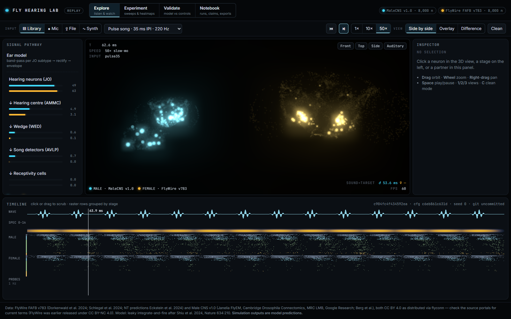

Fly Hearing Lab connects three things:
1. **Real wiring diagrams.** Synapse-level connectomes of an adult male and an adult female *Drosophila* brain.
2. **A simple neuron model.** Leaky integrate-and-fire, as in Shiu et al. 2024, *Nature*.
3. **An ear model.** It turns any audio (microphone, file, or synthesised fly song) into input for the hearing neurons.

It then tests one question with automatic controls and records every run so results can be reproduced.

> ⚠️ **Everything the simulation produces is a model prediction, not a measurement of a real fly.**

---

## Contents

1. [The question](#1-the-question)
2. [Tour of the app](#2-tour-of-the-app)
3. [How it works](#3-how-it-works)
4. [The tests](#4-the-tests)
5. [Results](#5-results)
6. [Conclusion](#6-conclusion)
7. [Limitations](#7-limitations)
8. [Run it yourself](#8-run-it-yourself)
9. [Repository layout](#9-repository-layout)
10. [Credits and licences](#10-credits-and-licences)

---

## 1. The question

A courting male fly vibrates one wing to make **pulse song**: short clicks separated by a species-specific gap, the **inter-pulse interval (IPI)**. For *D. melanogaster* the IPI is about 35 ms. Females are more receptive to song with the right rhythm. Neurons along the hearing pathway that respond to song have been recorded:

```
antenna (Johnston's organ, JO) → AMMC "hearing centre" → wedge (WED) → AVLP song detectors (pC2, vpoEN) → receptivity cells (pC1, vpoDN)
```

**Hypothesis.** If the *wiring alone* makes this circuit song-selective, then in the simulation:
1. The song-detector and receptivity cells (the **target set**) fire more for pulse song than for the same sound with its rhythm destroyed, or for noise.
2. Their response peaks near the natural IPI (~35 ms).
3. Both effects depend on the real wiring: they disappear if the connections are shuffled, and they survive reasonable uncertainty in the data.

Running the same sounds through a male and a female connectome also shows what the **wiring differences between the sexes** predict.

---

## 2. Tour of the app

The app is a static web page; everything runs in the browser.

### Explore: listen and watch

| | |
|---|---|
| 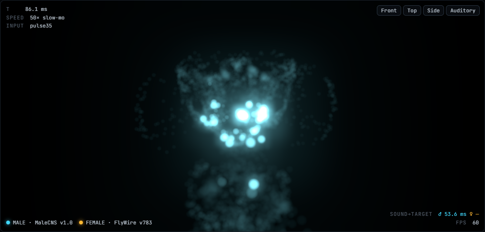 | **3D brains.** Every point is a neuron in the hearing subnetwork (8,000 per sex). A spike flashes and fades over ~200 ms. Male is cyan, female amber. The *Auditory* camera preset zooms in on the antennal hearing centre, where the activity starts. |
| 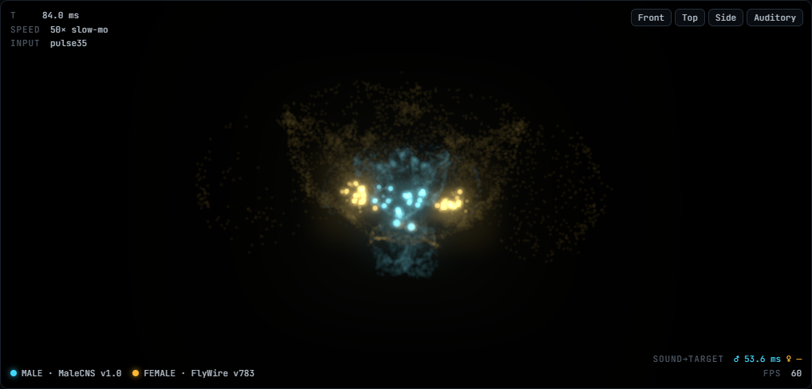 | **Overlay view.** Both brains are drawn on top of each other in a shared normalised space. |
| 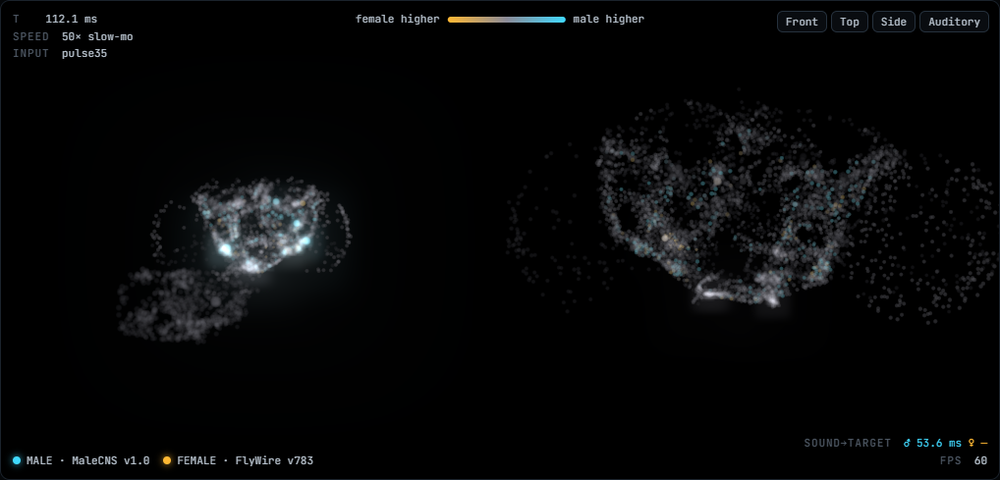 | **Difference view.** Each neuron is coloured by how much more its cell type fires in the male (cyan) or in the female (amber). Grey means equal; dark means the type exists in only one sex. |
| 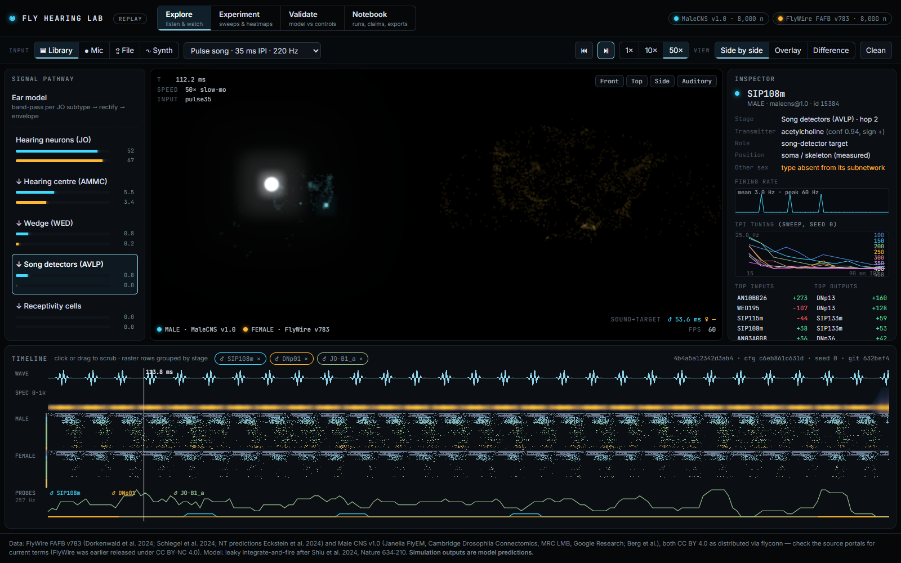 | **Signal pathway.** The left panel shows live spikes per second for each stage, from ear to receptivity cells, for both sexes. Clicking a stage shows only those neurons in 3D. |
| 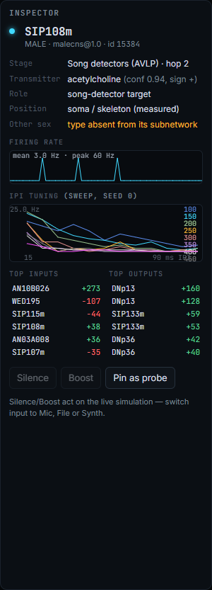 | **Inspector.** Click any neuron to see its cell type, ID, transmitter and how confident that prediction is, its strongest inputs and outputs (click to follow them), a firing-rate trace, and its tuning curve across the IPI sweep. In live mode you can also silence or boost the neuron. |
| 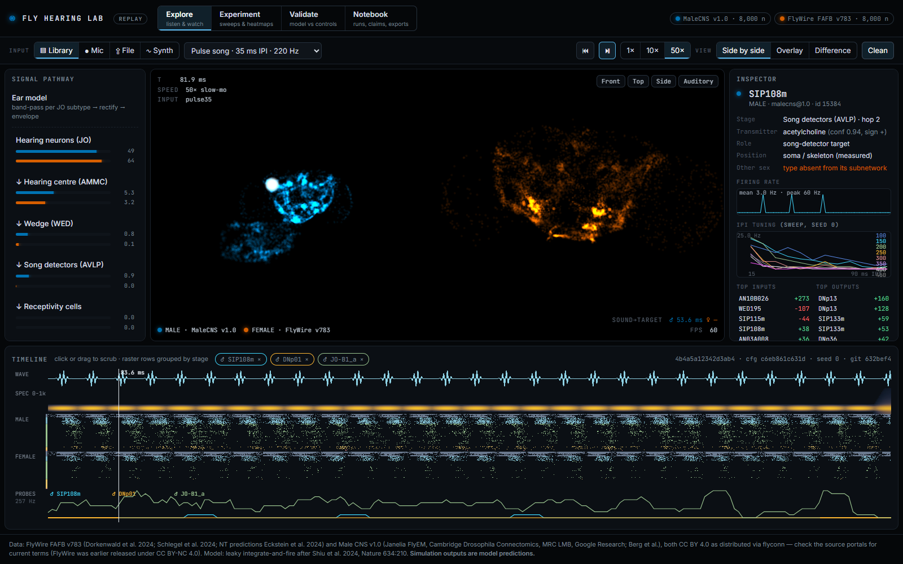 | **Clean mode** (`C`). No glow, and a colour-blind-safe palette (Okabe–Ito), for figures and accessibility. |

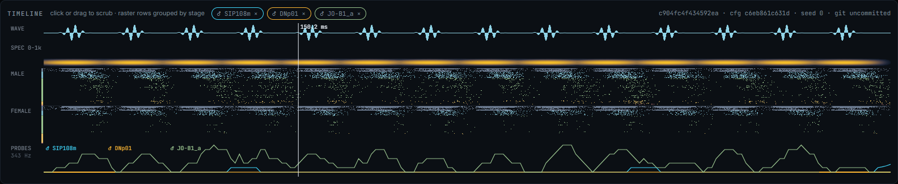
**Timeline.** Waveform, spectrogram, a spike raster (one row per neuron, grouped by pathway stage, male above female) and the firing traces of pinned "probe" neurons. Click or drag to jump to any millisecond.

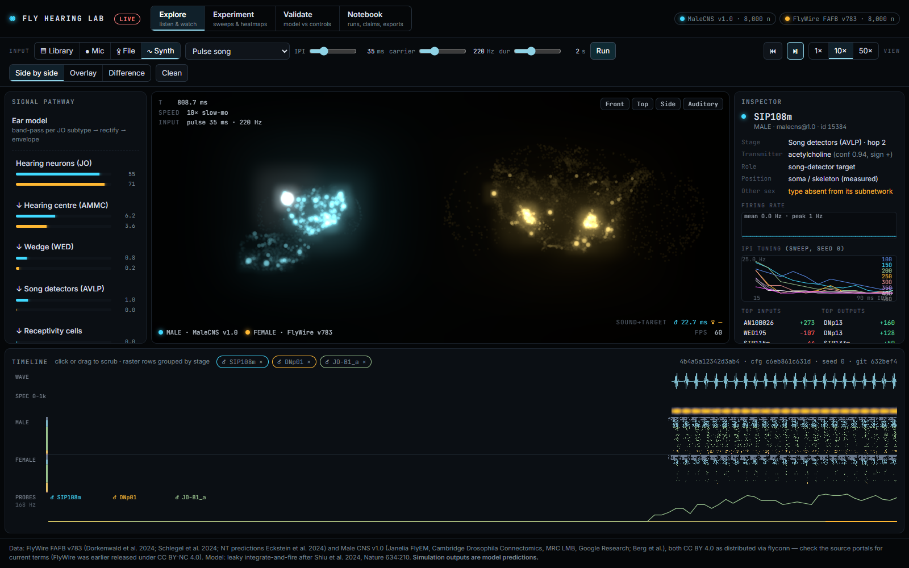
**Live mode.** Choose *Mic*, *File* or *Synth* and the browser runs the ear model and the neuron simulation in real time, using the same equations as the Python pipeline. At 1×/10×/50× slow motion the audio plays back slowed down, so its pitch drops by the same factor.

### Experiment, Validate, Notebook

| | |
|---|---|
| 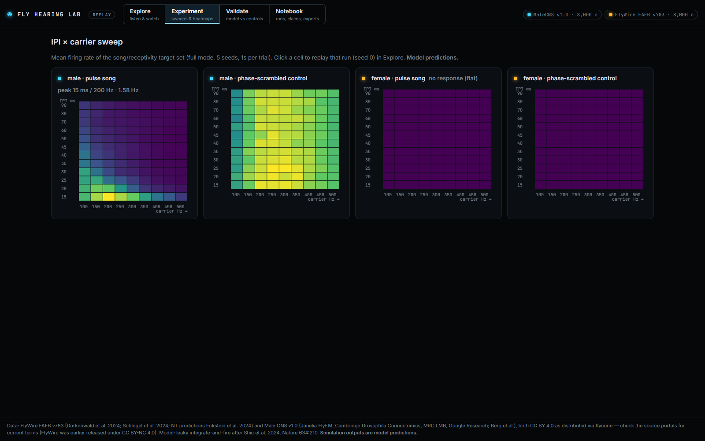 | **Experiment.** IPI × carrier heatmaps of the target-set response for each sex, for real song and for the phase-scrambled control. Click a cell to replay that exact run. |
| 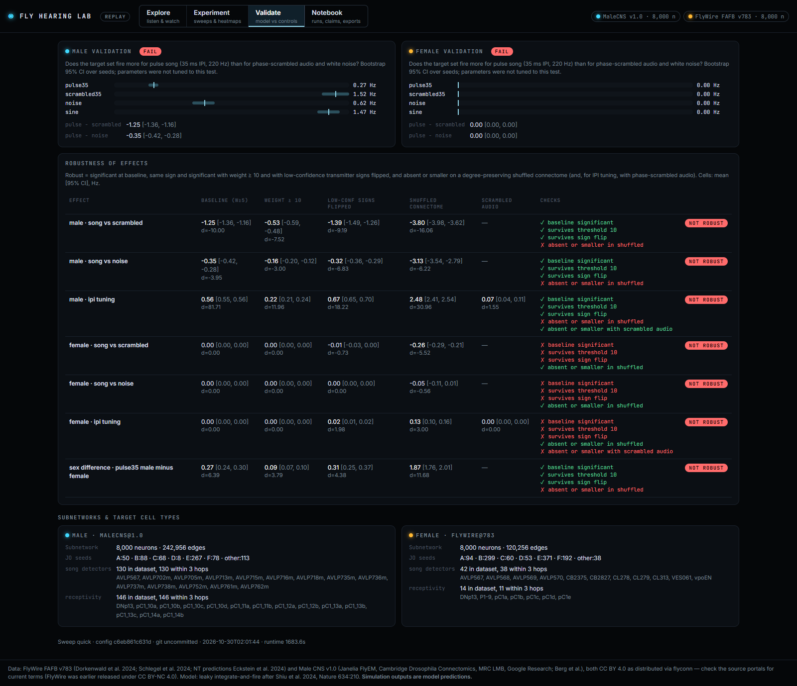 | **Validate.** PASS/FAIL for the validation check, the response to each reference sound with confidence intervals, and a robustness table that shows each effect under every control with a ROBUST / NOT ROBUST badge. |
| 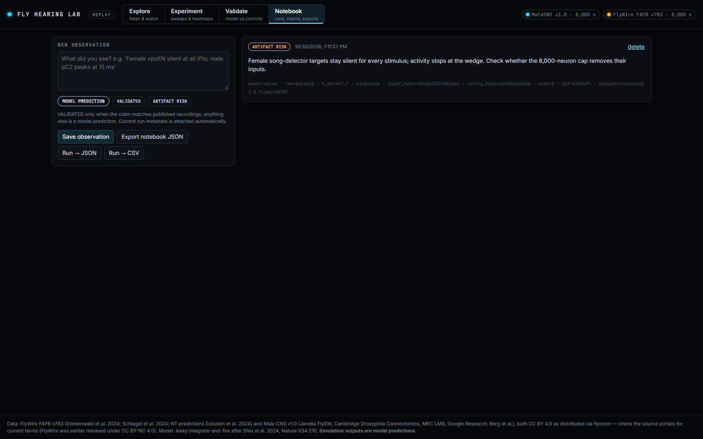 | **Notebook.** Save observations tagged *VALIDATED*, *MODEL PREDICTION* or *ARTIFACT RISK*; the current run's metadata is attached automatically. Export the notebook as JSON and any run as JSON or CSV. |

---

## 3. How it works

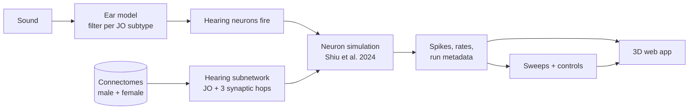

1. **Connectomes.** Both wiring diagrams are downloaded with [flyconn](https://pypi.org/project/flyconn/).
2. **Hearing subnetwork.** It starts at the antenna's hearing neurons (Johnston's organ: 672 in the male data, 1,107 in the female) and follows connections of at least 5 synapses for 3 hops. The strongest paths are kept, up to 8,000 neurons. Song-detector and receptivity cells are always included.
3. **Ear model.** Each hearing-neuron subtype gets a frequency band (JO-A higher, JO-B lower). The sound's envelope in that band sets how fast those neurons fire.
4. **Simulation.** Each neuron is a leaky integrate-and-fire unit with the published parameters. Synapses are excitatory (acetylcholine) or inhibitory (GABA, glutamate), with a strength proportional to the synapse count.
5. **Recording.** Every run saves the audio hash, dataset versions, config hash, random seed and git commit.

Full details, every parameter and every assumption: **[docs/METHODS.md](docs/METHODS.md)**.

---

## 4. The tests

| Test | What it asks | How |
|---|---|---|
| **IPI × carrier sweep** | Which rhythm and pitch drive the target cells most? | 12 IPIs (15–90 ms) × 9 carriers (100–500 Hz) × 5 seeds × 2 sexes |
| **Validation check** | Is pulse song > scrambled song, and pulse song > noise? | Both differences must have 95 % confidence intervals above 0 |
| **Shuffled connectome** | Does the effect need the *real* wiring? | Rewire randomly while keeping every neuron's number of connections |
| **Phase-scrambled audio** | Does the circuit track *rhythm*, or just sound energy? | Same frequencies, random timing |
| **Weight threshold 10** | Does it depend on weak, possibly wrong connections? | Rerun with only connections of ≥ 10 synapses |
| **Sign uncertainty** | Does it depend on uncertain transmitter guesses? | Flip excitation/inhibition for low-confidence neurons |

An effect counts as **robust** only if it survives the threshold and sign-uncertainty tests **and** becomes smaller or disappears with shuffled wiring. No parameter was adjusted to make a test pass.

---

## 5. Results

<!-- RESULTS:START -->
_Results are being finalised from the full sweep. See [docs/RESULTS.md](docs/RESULTS.md) for every number._
<!-- RESULTS:END -->

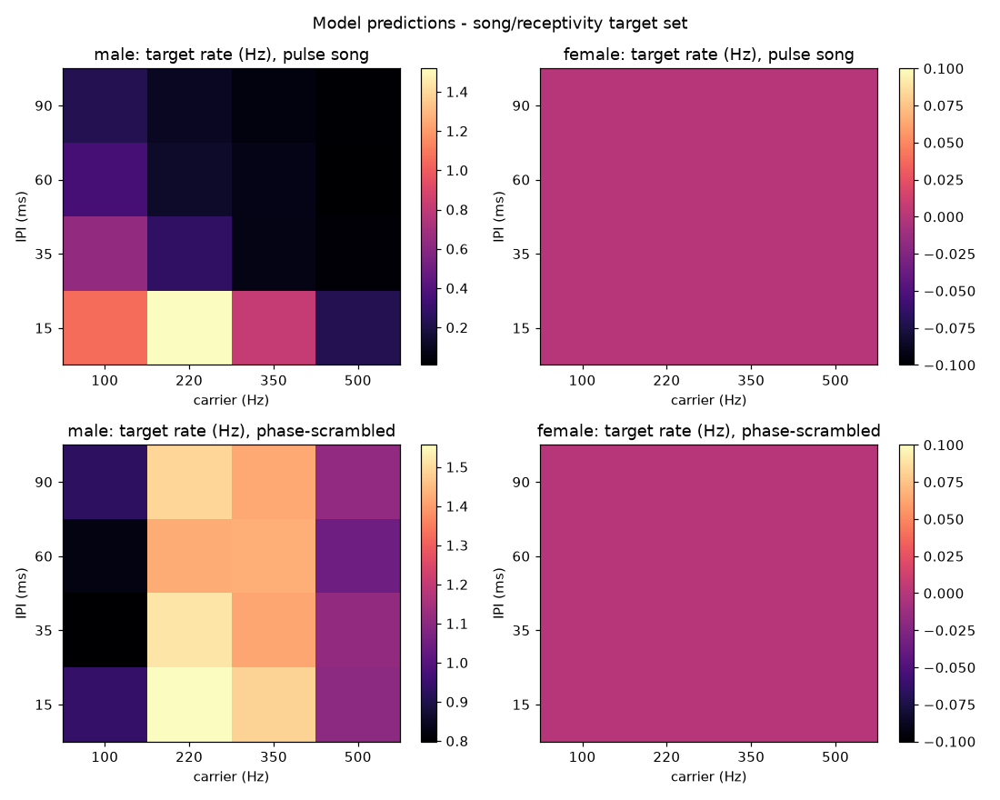

All tables (subnetworks, validation, the full grids, robustness, stage-by-stage rates) are in **[docs/RESULTS.md](docs/RESULTS.md)**, generated directly from `results.json` by `docs/make_results.py`.

---

## 6. Conclusion

<!-- CONCLUSION:START -->
_To be written from the full-sweep results._
<!-- CONCLUSION:END -->

---

## 7. Limitations

- **Subnetwork cut-off.** Each brain is cut down to 8,000 neurons and inputs from outside are dropped. A silent stage may be an artefact of the cut-off, not biology.
- **Simple neurons.** No gap junctions, neuromodulators, adaptation or dendritic processing, all of which real auditory neurons use.
- **Assumed ear.** The frequency tuning of the hearing-neuron subtypes is set from qualitative literature, not fitted. Inputs are normalised to equal loudness.
- **Uncalibrated synapse strengths.** The male value comes from flyconn's calibration protocol; the female value is Shiu's FlyWire v630 value applied to v783 with a 5-synapse threshold. Neither is validated for auditory responses.
- **Unequal coverage.** The male data covers the whole central nervous system, including the ventral nerve cord; FlyWire covers the brain only.
- **No measured positions for male hearing neurons.** They are placed near their partners (flagged in the app).
- **Live mode.** Microphone loudness is not calibrated (use the gain slider).

---

## 8. Run it yourself

Requirements: Python 3.11+, Node 18+, about 3 GB of disk, Chrome or Edge for the smoke and screenshot scripts. A GPU is optional (CUDA is used if available).

```bash
# Python pipeline
python -m pip install uv
python -m uv venv --system-site-packages .venv
python -m uv pip install --python .venv/Scripts/python.exe -r pyproject.toml

.venv/Scripts/python.exe pipeline/run_all.py --smoke   # tiny debug run (~1 min)
.venv/Scripts/python.exe pipeline/run_all.py --quick   # 4×4 grid (~15–30 min on 8 CPU cores)
.venv/Scripts/python.exe pipeline/run_all.py           # full 12×9 grid (~3 h on CPU)
.venv/Scripts/python.exe docs/make_results.py          # regenerate docs/RESULTS.md

# Web app
cd web
npm install
npm run dev          # http://localhost:5173
npm run build        # static site in web/dist
npm run smoke        # headless check: loads the page, fails on console errors
npm run shots        # regenerate the screenshots in docs/images
```

On macOS or Linux, use `.venv/bin/python` instead of `.venv/Scripts/python.exe`.

The first run downloads about 1.2 GB of connectome data into `data/` (cached afterwards). After that, everything runs offline on your own machine.

**Deploy (optional).** The web app is a static site, for example:

```bash
cd web && npm run build && npx wrangler pages deploy dist --project-name fly-hearing-lab
```

---

## 9. Repository layout

```
pipeline/
  config.yaml      all parameters (ASSUMPTIONs marked)
  data.py          download + neuron metadata + 3D positions
  subnet.py        hearing subnetwork per sex
  ear.py           ear model + built-in stimuli
  sim.py           batched LIF simulator + run metadata
  experiments.py   sweeps, controls, statistics, validation
  export.py        binary/JSON export for the web app
  run_all.py       runs every phase in order
web/
  src/             main, scene (three.js), timeline, inspector, audio, liveSim.worker, notebook, ear
  scripts/         smoke.mjs (headless check), screenshots.mjs (docs images)
docs/
  METHODS.md       full methods
  RESULTS.md       generated results tables
  images/          screenshots
data/              downloaded datasets and outputs (not committed; recreated by the pipeline)
```

---

## 10. Credits and licences

- **FlyWire FAFB v783:** Dorkenwald et al. 2024 and Schlegel et al. 2024, *Nature*; neurotransmitter predictions by Eckstein et al. 2024, *Cell*.
- **Male CNS v1.0:** Janelia FlyEM, Cambridge Drosophila Connectomics, MRC LMB, Google Research (Berg et al.).
- **Neuron model:** Shiu et al. 2024, *Nature* 634:210.
- **Data access:** [flyconn](https://pypi.org/project/flyconn/).

**Code:** [MIT licence](LICENSE). Use, copy, modify and redistribute it freely, including commercially; just keep the copyright notice.

**Data:** the connectome datasets have their own licences, separate from the code. flyconn distributes both datasets under CC BY 4.0. FlyWire was earlier released under CC BY-NC 4.0, so check each data portal's current terms before reusing the data. The connectome data is **not** included in this repository; the pipeline downloads it.

**Citing:** see [CITATION.cff](CITATION.cff); GitHub's "Cite this repository" button reads it.

**Simulation outputs are model predictions.**
