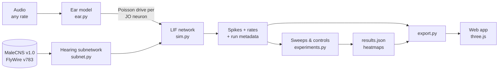

# Methods

This is the detailed version of the pipeline described in the [README](../README.md). Every tunable value lives in [`pipeline/config.yaml`](../pipeline/config.yaml). Values marked **ASSUMPTION** there are modelling choices, not measurements.

## 1. Data (`data.py`)

| | Male | Female |
|---|---|---|
| Dataset | MaleCNS v1.0 (`malecns@1.0`) | FlyWire FAFB v783 (`flywire@783`) |
| Source | `flyconn data pull --level weights` | same |
| Size | 166,700 neurons, 25.6 M edges | 139,255 neurons, 2.7 M edges |
| 3D position | `somaLocation`, else `tosomaLocation` | `soma_xyz`, else `pos_xyz` (flywire_annotations table) |
| Transmitter | predicted NT + confidence | predicted NT + confidence (Eckstein et al. 2024) |

If a neuron has no position (all MaleCNS JO afferents), it is placed at the mean position of its positioned partners. The inspector flags these as **layout fallback**.

## 2. Hearing subnetwork (`subnet.py`)

1. **Seeds:** cell types matching `^JO-` (Johnston's organ afferents), grouped by subtype letter (A–F; anything else goes to "other").
2. **Expansion:** downstream neurons up to 3 hops away, keeping only connections of ≥ 5 synapses.
3. **Scoring:** a neuron's score is the product of input fractions (synapses / total input of the postsynaptic cell) along its best path from a JO neuron.
4. **Cap of 8,000 neurons:** seeds and target cells are always kept. Of the remaining slots, half go to neurons on the strongest JO → target paths (forward score × backward score from the targets) and half to the highest forward scores.
5. **Signs (Shiu et al. 2024):** acetylcholine +1, GABA and glutamate −1, everything else 0.
6. **Targets:** found by regex on cell type plus synonyms.
   - *Song detectors:* `vpoEN`, `pC2l/m` (including synonym matches such as AVLP567–570), `vPN1`.
   - *Receptivity:* `pC1`, `vpoDN`/`DNp13`, `P1`.
   - VNC types (vPR, pMN) are excluded because FlyWire has no VNC.
7. **Pathway stages** (used in the app): JO → hearing centre (AMMC) → wedge (WED) → song detectors (AVLP) → receptivity. Stages are assigned by name first, then by hop distance.

## 3. Ear model (`ear.py`)

Waveform → resample to 10 kHz → normalise to unit RMS → per-subtype 2nd-order Butterworth band-pass → half-wave rectify → 80 Hz envelope low-pass → drive `d = e/(1+e)` with `e = gain · envelope / 0.05`. JO neurons then fire as inhomogeneous Poisson processes at rate `2 + 250·d` Hz.

| JO subtype | Filter | Gain | Rationale (qualitative) |
|---|---|---|---|
| A | 400 Hz, Q 1.2 | 1.0 | vibration-sensitive, higher frequency (Kamikouchi 2009) |
| B | 150 Hz, Q 1.2 | 1.0 | vibration-sensitive, lower frequency (Kamikouchi 2009; Yorozu 2009) |
| D | 250 Hz, Q 1.0 | 0.6 | intermediate (Matsuo 2014) |
| C, E | 20 Hz low-pass | 0.15 | static deflection: wind and gravity |
| F, other | 250 Hz, Q 0.7 | 0.3 | uncharacterised |

Each neuron gets jitter: lognormal gain (σ 0.15) and centre frequency ±5 %. Both are seeded per trial.

**Built-in stimuli:**
- *Pulse song:* Gaussian-windowed 3-cycle carrier pulses repeated at the IPI.
- *Sine song:* 150 Hz.
- *White noise.*
- *Phase-scrambled pulse song:* same amplitude spectrum, random phases, so the rhythm is destroyed.

## 4. Simulator (`sim.py`)

Leaky integrate-and-fire with the parameters of Shiu et al. 2024:

| Parameter | Value |
|---|---|
| Resting / reset potential | −52 mV |
| Threshold | −45 mV |
| Membrane τ | 20 ms |
| Synaptic τ | 5 ms |
| Refractory period | 2.2 ms |
| Synaptic delay | 1.8 ms |
| Time step | 0.1 ms |
| w_syn | 0.275 mV (FlyWire, Shiu's value); 0.188 mV (MaleCNS, flyconn's re-calibration protocol) |
| Poisson kick | 250 × w_syn |

- **Integration:** exact (closed-form) update.
- **Execution:** trials run as a batch in PyTorch, with event-driven synaptic delivery so that work scales with the number of spikes.
- **Metadata saved with every run:** input audio hash, dataset, config hash, seed, git commit, network variant, w_syn.

## 5. Experiments and controls (`experiments.py`)

**Hypothesis.** If the wiring alone makes the circuit song-selective, the target set should fire more for conspecific pulse song than for the same sound with its rhythm destroyed. It should also show a preferred IPI near 35 ms, and the effect should depend on the real wiring.

**Sweep.**
- *Quick:* IPI {15, 35, 60, 90} ms × carrier {100, 220, 350, 500} Hz, 0.5 s trials.
- *Full:* IPI 15–90 ms (12 values) × carrier 100–500 Hz (9 values), 1 s trials.
- Both use 5 seeds per condition, in both sexes.

**Metric.** Mean firing rate of the target set.

**Controls, run automatically:**

| Control | What it rules out |
|---|---|
| Degree-preserving shuffle (targets permuted across edges, so every in/out degree and weight multiset is kept) | that any network this dense would give the effect |
| Phase-scrambled audio, over the whole grid | that the circuit tracks sound energy rather than rhythm |
| Weight threshold 10 instead of 5 | dependence on weak, possibly erroneous connections |
| Low-confidence (< 0.6) transmitter signs flipped | dependence on uncertain excitation/inhibition labels |

**Statistics.** Per-seed effects, bootstrap 95 % CI (2,000 resamples) and Cohen's d.

**An effect is robust when all of these hold:**
- it is significant at baseline;
- it keeps the same sign and significance at weight ≥ 10;
- it keeps the same sign and significance with signs flipped;
- it is absent or significantly smaller on the shuffled connectome;
- for IPI tuning, it is also smaller with scrambled audio.

**Validation.** For each sex, the target response to pulse song (35 ms, 220 Hz) must exceed both scrambled song and white noise, with both CIs above 0. No parameter was tuned against this test.

## 6. Export and web app

`export.py` writes the following to `web/public/data/`:
- normalised positions (float32)
- CSR adjacency (int32 indices, float32 signed mV weights) and raw synapse counts
- neuron metadata (JSON)
- one binary per run: spike ids (uint32), spike times (float32), per-neuron rates, audio, stage rates
- `sweep.json`
- the ear's SOS filter coefficients, so the browser applies exactly the same filters as scipy

The export is capped at 150 MB. Runs are kept in priority order: reference stimuli first, then the pulse grid, then the scrambled grid.

The browser's live mode runs the same equations:
- **Mic input:** an AudioWorklet runs the ear model at 10 kHz.
- **Simulation:** a Web Worker runs the event-driven LIF on both subnetworks.
- **Speed fallback:** if rendering stays below 30 fps, the worker drops to the 3,000 highest-priority neurons.
